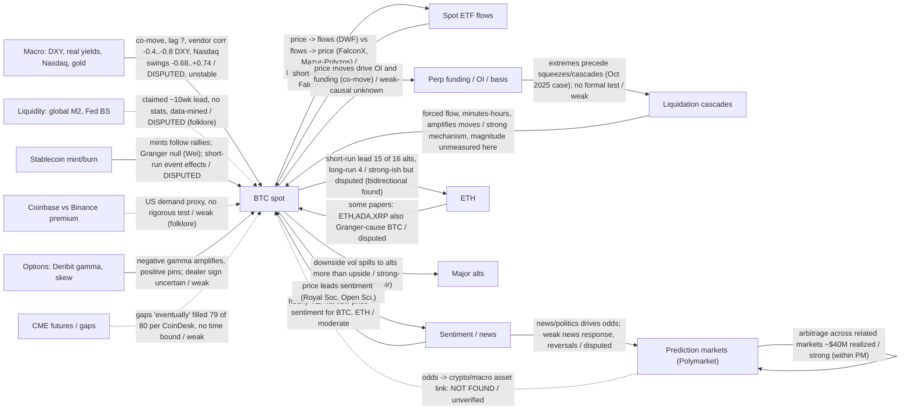

# 04 - Connections and Causal Flow (what drives what, what leads what)

Date: 2026-11-15. Method: web search summaries only. WebFetch to falconx.io and cointelegraph.com failed (host not in the session's allowed network domains), so almost every claim below rests on search-result summaries of abstracts or secondary write-ups, NOT on reading the primary papers. No market-data APIs were reachable, so no numbers were computed here and none are invented. Where no number was found, it says so.

## Key findings

1. **There is almost no rigorous, out-of-sample, tradeable lead-lag evidence in the public record for crypto.** Most "signals" (funding, Coinbase premium, USDT mints, M2 lead, CME gaps) are supported only by vendor charts, blogs, or small-sample tallies. Treat every one as folklore until we test it ourselves.
2. **BTC -> alts is the best-supported link, but it is not clean.** One summary reports BTC drives 15 of 16 altcoins short-run but only 4 over longer horizons; other papers find bidirectional causality (ETH, ADA, XRP also cause BTC) and one finds BTC does not lead the information process. Result depends on method, horizon and sample. Sources: https://pmc.ncbi.nlm.nih.gov/articles/PMC8624574 , https://discovery-pp.ucl.ac.uk/10111783/1/rsos.200863.pdf , https://mdpi.com/1099-4300/21/11/1116
3. **Volatility transmission BTC -> alts is asymmetric**: a BTC decline affects alts more than a BTC rise (Balcilar and Ozdemir, JRFM). Connectedness is stronger at short frequencies. Source: https://mdpi.com/1911-8074/16/1/41
4. **ETF flows: contested direction.** FalconX (non-peer-reviewed) reports short-term predictive power of flows for price with a feedback loop (price rises dampen inflows); DWF Labs says flows follow price; Mazur and Polyzos (2025) say net flows predict price levels and most price change happens outside ETF hours. Cointegration of ETF assets and price shown but cannot separate cause from common driver. Sources: https://falconx.io/newsroom/what-can-spot-etf-flows-tell-us-about-the-trajectory-of-bitcoin-prices-a-preliminary-statistical-investigation , https://cointelegraph.com/news/bitcoin-etf-flows-follow-price-trends-dwf-labs , https://zuscholars.zu.ac.ae/works/7267 , https://ledger.pitt.edu/ojs/ledger/article/view/393
5. **Stablecoin mints mostly follow rallies or co-move; causal effect is disputed.** Wei found no Granger/VAR causality of Tether issuance on BTC; Lyons and Viswanath-Natraj found no systematic price effect; Griffin and Shams (J. Finance 2020) found 2017 Tether flows associated with BTC rises after downturns (manipulation hypothesis), disputed by Bitfinex/Tether and critics (on-chain data limits). Event-study work finds short-run abnormal returns. Sources: https://arxiv.org/pdf/2507.13883 , https://voxeu.org/article/stable-coins-dont-inflate-crypto-markets , https://econpapers.repec.org/RePEc:bla:jfinan:v:75:y:2020:i:4:p:1913-1964 , https://cointelegraph.com/news/usdt-mints-bitcoin-price
6. **Perp mechanics are rigorously described, but funding as a reversal predictor is NOT academically tested** (search found only commentary). He, Manela, Ross, von Wachter show perp-vs-no-arbitrage deviations are large, comove, and shrink over time; a deviation-trading strategy reported Sharpe 1.8 at high retail costs (3.5 for market makers), and arbitrage can fail because mispricing outlasts solvency. Source: https://arxiv.org/abs/2212.06888
7. **Liquidation cascades are real and venue-specific.** 10 Oct 2025: roughly $19B liquidated (some say understated, up to $50B+), funding had risen from ~10% to ~30% annualized by 6 Oct, funding then flipped negative/near zero, OI fell by roughly $50-65B depending on source, BTC back near $112k by 12 Oct. Source: https://www.fticonsulting.com/insights/articles/crypto-crash-october-2025-leverage-met-liquidity , https://coinshares.com/be/insights/knowledge/billions-in-liquidations-what-happened , https://insights4vc.substack.com/p/inside-the-19b-flash-crash
8. **Macro correlations are unstable.** Vendor figures: BTC-DXY rolling correlation reported -0.4 to -0.8 (most persistent), BTC-Nasdaq 0.4-0.7 with a reported 30-day swing from -0.68 to +0.74 within weeks (2026), BTC-gold ~0.2-0.4 or near zero depending on source. All from vendors/blogs, not peer review. Sources: https://sharpe.ai/correlation/crypto-vs-tradfi , https://ecoinometrics.substack.com/p/ecoinometrics-correlations-three , https://www.spark.money/tools/bitcoin-correlation-calculator
9. **Global M2 "10-week lead" is unverified and likely data-mined** (lag tuned afterward to 56-60 days; no stats, no out-of-sample). Source: https://bitcoinmagazine.com/markets/global-liquidity-fuels-bitcoin-price
10. **Time-of-day effects**: peer-reviewed (Baur et al. 2019, 15M observations, 7 exchanges) finds time-specific anomalies but no persistence over time, and persistent differences in activity (lower in local evening/weekends). Industry reports show US-session positive / Asia negative for 2019-2021 and 2022, untested for significance. Sources: https://econpapers.repec.org/RePEc:eee:finlet:v:31:y:2019:i:c:p:78-92 , https://ambcrypto.com/bitcoins-price-and-how-u-s-asian-trading-sessions-affect-it/
11. **CME gaps**: CoinDesk tally (Mar 2025) says all but one of the previous 80 gaps were eventually filled. "Eventually" is undefined in time and drawdown, so it is not a tradeable statistic. No formal study found. Source: https://dev.coindesk.com/markets/2025/03/11/bitcoin-fills-yet-another-cme-futures-gap-as-btc-price-dropped-to-usd76-700
12. **Prediction markets**: Polymarket has real cross-market arbitrage (estimated ~$40M realized, within-market rebalancing and combinatorial across markets; Saguillo et al., AFT 2025). Calibration is decent in aggregate (Princeton thesis, 188,509 resolved markets, per abstract), but a Vanderbilt study reports weak news response and 58% of national presidential markets with negative serial correlation (spike then reversal); a 2026 account study claims ~3% of traders skilled capturing ~30% of gains (unverified). Sources: https://arxiv.org/abs/2508.03474 , https://theses-dissertations.princeton.edu/entities/publication/d5708372-5ea3-4252-b669-7f9cee07387c , https://finance.yahoo.com/news/polymarket-kalshi-reliable-not-quite-201417879.html
13. **Options/gamma**: mechanism is clear (negative dealer gamma amplifies moves, positive dampens) but dealer sign inference is unreliable in crypto (Deribit: trade-direction heuristic differed in ~31.6% of BTC option volume, Q2 2023); no statistical test of GEX -> spot found. Sources: https://research.glassnode.com/gamma-exposure/ , https://insights.deribit.com/industry/decoding-option-flows-q2-2023/
14. **Coinbase premium**: widely cited (CryptoQuant), no rigorous test found. Source: https://cryptoquant.com/insights/quicktake/6ae77a721c48840a11173491

## Connection map (mermaid)

Edge label format: direction / lag / strength / confidence. "?" = lag not found in sources.

## Evidence table

| Link | Direction / lag | Source | Sample | Stability | Confidence |
|---|---|---|---|---|---|
| BTC -> alts (returns) | BTC leads in short run (15 of 16 alts), long run only 4; other papers bidirectional | https://pmc.ncbi.nlm.nih.gov/articles/PMC8624574 ; https://mdpi.com/1099-4300/21/11/1116 | Daily/hourly, various (sample dates not retrieved) | Method/horizon dependent; one paper finds BTC not leading | Weak-moderate / disputed |
| BTC -> alts (volatility) | Downside BTC shocks hit alts harder; stronger at short frequencies | https://mdpi.com/1911-8074/16/1/41 | DY VAR, dates not retrieved | Regime-split (bull/bear) results mixed | Moderate |
| Price -> sentiment (not reverse) | Net info flow price -> sentiment, hourly BTC/ETH | https://discovery-pp.ucl.ac.uk/10111783/1/rsos.200863.pdf | Hourly, dates not retrieved | Unknown | Moderate |
| ETF flows <-> BTC | Disputed: flows -> price (FalconX; Mazur-Polyzos) vs price -> flows (DWF); cointegration | FalconX URL above; https://zuscholars.zu.ac.ae/works/7267 ; DWF cointelegraph URL; https://ledger.pitt.edu/ojs/ledger/article/view/393 | Post Jan-2024 launch only (short) | Short history; regime-dependent | Weak / disputed |
| ETF "hedged basis trade" share | About a fifth of flows may be CME-hedged (DWF); Glassnode/Avenir says significant share unhedged | https://cointelegraph.com/news/bitcoin-etf-flows-follow-price-trends-dwf-labs | Short | Unknown | Weak |
| USDT mint -> BTC | Mints follow rallies; Granger null (Wei); Griffin-Shams: 2017 Tether flows after downturns, big-entity concentration | https://arxiv.org/pdf/2507.13883 ; https://econpapers.repec.org/RePEc:bla:jfinan:v:75:y:2020:i:4:p:1913-1964 | 2017 era (GS); daily (Wei) | Likely changed since 2017; no post-2024 test found | Disputed |
| Perp price vs no-arbitrage value | Mean deviation small/insignificant but large episodic gaps; funding pulls toward spot; Sharpe 1.8 (retail costs) | https://arxiv.org/abs/2212.06888 | Multi-year crypto perps | Deviations shrink over time | Moderate (theory + paper); returns not live-tradeable proof |
| Funding rate -> reversal | K33: 90-day BTC return after 30d avg funding turns negative, avg ~79%, median ~55% since 2018; method unpublished | https://www.theblock.co/amp/post/315831/perp-signal-bitcoin-bottom-bullish-year-end-k33 | Since 2018, tiny number of episodes | Unknown | Weak (folklore) |
| Funding/OI -> cascade | Funding ~10% to ~30% annualized pre-crash; liquidation ~$19B, OI -$50-65B | https://www.fticonsulting.com/insights/articles/crypto-crash-october-2025-leverage-met-liquidity ; https://coinshares.com/be/insights/knowledge/billions-in-liquidations-what-happened | Single event | N=1; trigger was exogenous (tariff news) | Mechanism strong, predictive power unproven |
| Options gamma -> spot | Negative gamma amplifies, positive pins | https://research.glassnode.com/gamma-exposure/ | Vendor model | Dealer sign unobservable (~31.6% direction mismatch, Deribit) | Weak |
| BTC vs DXY | Negative; vendor rolling range -0.4 to -0.8 | https://sharpe.ai/correlation/crypto-vs-tradfi | Since 2014 per vendor | Most persistent but wide range | Weak-moderate |
| BTC vs Nasdaq | Positive, 0.4-0.7; 30d swing -0.68 to +0.74 (2026) | same plus https://ecoinometrics.substack.com/p/ecoinometrics-correlations-three | 2020-2026 vendor | Highly unstable | Disputed |
| BTC vs gold | 0.2-0.4 or near zero | https://www.spark.money/tools/bitcoin-correlation-calculator | Vendor | Unstable | Weak |
| Global M2 -> BTC | ~10 weeks (later 56-60 days) | https://bitcoinmagazine.com/markets/global-liquidity-fuels-bitcoin-price | Chart only | Lag tuned post hoc; admitted inconsistencies | Folklore |
| Coinbase premium -> BTC | Positive premium = US demand | https://cryptoquant.com/insights/quicktake/6ae77a721c48840a11173491 | None stated | Unknown | Folklore |
| Session/time of day | US hours higher return/vol 2019-21; Asia negative; Baur et al. find no persistence | https://econpapers.repec.org/RePEc:eee:finlet:v:31:y:2019:i:c:p:78-92 ; https://ambcrypto.com/bitcoins-price-and-how-u-s-asian-trading-sessions-affect-it/ | 2019-2022 | Peer-reviewed: not persistent | Weak |
| CME gap fill | 79 of 80 eventually filled | https://dev.coindesk.com/markets/2025/03/11/bitcoin-fills-yet-another-cme-futures-gap-as-btc-price-dropped-to-usd76-700 | 80 gaps | No time bound; survivorship in "eventually" | Folklore |
| Polymarket combinatorial arb | Inconsistent related markets exploitable | https://arxiv.org/abs/2508.03474 | On-chain order books | Competition likely compresses it | Moderate |
| Polymarket news response | Weak reaction, serial-correlation reversals (58% of presidential markets) | https://finance.yahoo.com/news/polymarket-kalshi-reliable-not-quite-201417879.html | Elections; Kalshi disputes method | Elections-specific | Disputed |
| Polymarket odds -> crypto/macro asset | Not found | n/a | n/a | n/a | Unverified |

## Testable hypotheses (pass/fail rules)

All to be run by us on our own data, with a train/validation split by time (first 60% train, last 40% untouched), costs included (taker fee + half-spread + funding paid), and a Bonferroni-style correction across the hypotheses below (10 tests: require p < 0.005).

**H1. Funding extreme -> short-horizon reversal (BTC, ETH, SOL perps).**
Rule: on each 8h funding timestamp, if funding z-score (vs trailing 90d) > +2 AND OI 24h change > +0 (long crowding), go short at next bar for 24h (mirror for z < -2 long). Pass: out-of-sample mean net return per trade > 0 with block-bootstrap (block = 3 days) 95% CI excluding zero, n >= 100 signals, profitable in at least 3 of 4 calendar-year sub-samples. Fail otherwise. Data: perp funding history, OI history, mark/index prices (Binance, Bybit, OKX, Hyperliquid), hourly or finer.

**H2. Liquidation-cascade snapback.**
Rule: when aggregate liquidations in 1h exceed the trailing 180-day 99th percentile and price is down > 2 sigma (trailing 30d hourly) in that hour, buy at the close of that hour, exit after 24h, with stop at 1.5x the cascade low-to-entry range. Pass: net mean > 0, CI excludes zero, profit factor > 1.3 across at least 20 events, and result not driven by any single event (drop top 2 events, still positive). Data: liquidation feeds (Coinglass-type, noting under-reporting per CoinShares claim), 1-minute OHLC. Also test the opposite (continuation) since cascades with news (Oct 2025) may not snap back uniformly.

**H3. BTC leads ETH and alts at 1-60 min.**
Rule: estimate Granger (VAR, BIC-selected lags up to 12) and linear transfer entropy on 1-min returns, rolling 30-day windows, BTC -> ETH and BTC -> each of SOL and top alts, using same-venue perp mid prices. Pass: BTC->X significant (p < 0.005) in at least 80% of rolling windows AND a tradeable version (trade X in BTC's direction after a BTC 1-min move > 3 sigma, hold 5 min) has positive net return after realistic costs on validation set. Fail if edge disappears after fees (expected to be the main failure mode). Data: 1-min or tick perp data, same timestamps.

**H4. ETF flow direction (price -> flow vs flow -> price).**
Rule: daily US spot BTC ETF net flow (issuer data) vs BTC close-to-close return. Run Granger both ways with 1-5 lags on the full post-launch sample plus a rolling 180-day window. Pass for "flows lead price": flow(t-1) coefficient significant at p < 0.01 in the validation half AND next-day return conditional on top-quintile prior-day flow exceeds bottom-quintile by a margin whose bootstrap CI excludes zero. If price -> flow is significant and flow -> price is not, label flows as a lagging indicator. Data: daily ETF flows (Farside-type), BTC daily at 16:00 ET close to align with ETF NAV timing.

**H5. USDT/USDC net issuance -> subsequent returns.**
Rule: weekly net stablecoin supply change (Tether + Circle, on-chain) regressed on next-week BTC return, controlling for the prior-week return. Pass: coefficient on issuance significant (p < 0.01, Newey-West) AND stable sign in both halves; Fail if the coefficient vanishes when prior-week return is controlled (would confirm "mints follow price"). Data: on-chain mint/burn by chain, weekly BTC.

**H6. Coinbase premium (Coinbase BTC-USD minus Binance BTC-USDT, in basis points).**
Rule: z-score > +1.5 of premium (trailing 60d) -> long next 24h; < -1.5 -> short. Control for the USDT/USD basis. Pass: out-of-sample mean net > 0, CI excludes zero, n >= 100. Data: hourly Coinbase and Binance BTC closes, USDT/USD rate.

**H7. Macro regime gating.**
Rule: test whether BTC beta to Nasdaq futures (rolling 60d) predicts its own next-30d value (out-of-sample R^2 > 0 versus a constant-beta baseline). If R^2 <= 0, declare correlation-based macro hedging unreliable. Data: daily BTC, NQ, DXY, 10y TIPS yield, gold.

**H8. Global liquidity lead.**
Rule: pre-register a single lag (10 weeks) and a single measure (YoY global M2 change); compute correlation of its 10-week-lagged series with BTC 13-week returns on an out-of-sample window only. Pass: correlation > 0.3 with a stationary-bootstrap CI excluding zero, and beats a random-lag baseline (lags drawn 0-20 weeks) in the top 10% of that distribution. Fail otherwise. Data: global M2 (central bank aggregation, state data vintage), BTC weekly.

**H9. CME gap fill as a trade.**
Rule: for each weekend gap > 1% of price, record time to first fill and maximum adverse excursion before fill. Pass: median time-to-fill <= 7 days AND the strategy of trading toward the gap with a stop at 1x gap size has net expectancy > 0 over all gaps (not just filled ones). Fail if fill requires adverse excursion larger than gap. Data: CME BTC futures 5-min (Friday close/Sunday open).

**H10. Polymarket correlated-market inconsistency.**
Rule: for a set of logically linked markets (e.g., threshold ladders "BTC above X by date" and nested outcomes), flag sums or monotonicity violations exceeding spread + fees + 2 cents. Pass: executable at displayed depth with positive net PnL on recorded order-book snapshots (not mid), persistence long enough for a realistic latency assumption (>= several seconds, to be measured). Separate test: does a Polymarket crypto-threshold odds change lead the underlying (futures price) at 1-60 min? Pass: lead-lag cross-correlation peak at positive lag with p < 0.005 and positive net trade return. Data: Polymarket CLOB snapshots/trades, concurrent spot/futures at 1 s to 1 min.

## What we could NOT verify

- Primary papers were not read; every statement is from search-result summaries (WebFetch blocked on falconx.io and cointelegraph.com, not tested on others). Sample periods, lags, coefficient sizes and p-values for the Granger/TE studies are missing.
- Effect sizes (return per signal, R^2) for nearly every link: not found. No number was computed here.
- Any rigorous test of funding/OI/basis predicting returns, dealer gamma predicting spot, Coinbase premium predicting returns, CME gap trading, or Binance-vs-Coinbase / Asia-vs-US lead-lag beyond vendor charts.
- Real-yield correlation with BTC (only indirect statements found); DXY correlation figures are vendor-reported.
- Whether the Wei null on Tether and the Griffin-Shams result hold after 2020; post-2024 stablecoin-mint studies were not found.
- ETF-hours vs non-ETF-hours price discovery details (Mazur-Polyzos) and Gemayel et al., Kia et al. price-discovery findings (titles only).
- Polymarket odds -> crypto/macro asset relationship: nothing found. The "3% skilled traders capture 30% of gains" claim and the Vanderbilt accuracy numbers are secondary reports; Kalshi disputes the latter's method.
- Liquidation totals are venue-API dependent (CoinShares and a Hyperliquid cofounder say reported figures are understated).
- Cross-asset transfer entropy for macro assets (Nasdaq, gold, DXY) with crypto was not located in retrievable form.

## Ways a trader loses here (traps)

1. **Correlation sold as causation.** USDT mints, ETF inflows, M2, and premium indices are mostly co-moving or following price. Trading them as leading signals pays the lag twice.
2. **Lag mining.** The "10-week M2 lead" was tuned to 56-60 days after the fact. Any lag chosen by looking at the chart will fail out of sample.
3. **Unstable correlations.** A 30-day BTC-Nasdaq correlation swung from -0.68 to +0.74 in weeks (vendor data); hedging or sizing off a rolling correlation can invert.
4. **Funding as a contrarian trigger.** Extreme funding can persist through a trend, and the cascade can arrive from an exogenous shock (Oct 2025 tariff post) rather than from funding itself. Shorting "overheated" funding early can be squeezed; going long "negative funding" during a real cascade can be buying into continuation.
5. **Small-N signals.** K33 funding statistic (avg ~79% vs median ~55%) is a handful of episodes; the mean is dominated by outliers.
6. **CME gap survivorship.** "79 of 80 filled" says nothing about how long, or how far price travels against you first.
7. **Lead-lag edges are smaller than costs.** BTC -> alt lead at minute scale is the sort of edge latency-advantaged players already take; with retail fees and slippage it likely nets to zero. Test net of costs only.
8. **Dealer-gamma false precision.** Dealer sign is inferred, not observed; GEX levels may be wrong in sign.
9. **Liquidation data is incomplete.** Binance API throttling reportedly captured a small fraction in Oct 2025, so liquidation-based signals have unknown, venue-dependent measurement error.
10. **Basis/perp arbitrage looks riskless but is not.** Mispricing can persist beyond solvency; margin, venue, and unified-margin cross-liquidation risk (as in Oct 2025) can wipe out the "hedged" leg.
11. **Prediction-market quirks.** Spike-and-reverse behaviour, thin books, and resolution-wording risk; apparent cross-market inconsistencies may not be executable at depth, and the profit pool is being competed (arbitrage already exploited, est. $40M).
12. **Session effects.** Published US-vs-Asia return differences are short-sample and not shown persistent in the peer-reviewed study; only the volatility/activity pattern is consistent.
13. **Regime change.** ETF era (post Jan-2024) and post-2020 market structure differ from the samples in older studies; many cited results predate it.
